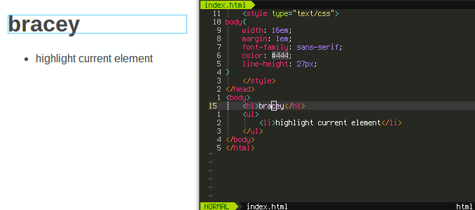

# bracey.nvim


Live HTML, CSS, and JavaScript editing in **Neovim**, packaged for
[lazy.nvim](https://github.com/folke/lazy.nvim).



## Features

- **Live HTML editing** — changes in Neovim are pushed to the browser instantly
- **Live CSS editing** (the cool feature) — place your cursor on a CSS rule and
  bracey highlights every element that rule selects in the browser. CSS edits
  are hot-reloaded without a page refresh
- **Live JavaScript** — evaluate JavaScript in the browser on save or with
  `:BraceyEval`
- **Buffer ↔ page sync** — switching buffers keeps the browser on the matching
  HTML page
- **No Python required** — the old `bracey.vim` depended on Vim's Python
  support. `bracey.nvim` is pure Lua and works on any Neovim build
- **lazy.nvim ready** — install with a single plugin spec

## Installation

With [lazy.nvim](https://github.com/folke/lazy.nvim), add this to your plugins
file (e.g. `lua/plugins/bracey.lua`):

```lua
return {
  {
    "a0x14D/bracy.nvim",
    dependencies = {},
    opts = {
      auto_start_browser = true,
      -- eval_on_save = true,
      -- refresh_on_save = false,
      -- server_port = 12345,   -- nil => random port from nvim's pid
      -- server_path = "http://127.0.0.1",
      -- server_log = nil,       -- e.g. "/tmp/bracey_server.log"
      -- server_allow_remote_connections = false,
    },
    cmd = { "Bracey", "BraceyStop", "BraceyReload", "BraceyEval" },
    build = "npm install --prefix server",
  },
}
```

If you are working on this local copy instead of a GitHub remote, point `dir` at
the checkout:

```lua
return {
  {
    dir = "~/gits/bracey.vim",
    opts = {},
    cmd = { "Bracey", "BraceyStop", "BraceyReload", "BraceyEval" },
    build = "npm install --prefix server",
  },
}
```

> **Note:** bracey requires [Node.js](https://nodejs.org/) and `npm` to run the
> live-editing server. The `build` field runs `npm install --prefix server`
> automatically on install/update. If you don't use `build`, run
> `npm install --prefix server` inside the plugin directory once.

## Usage

| Command | Description |
|---------|-------------|
| `:Bracey` | Start the bracey server and open the browser |
| `:BraceyStop` | Stop the server |
| `:BraceyReload` | Reload the current browser page |
| `:BraceyEval [js]` | Evaluate JavaScript in the browser (uses args or the whole buffer) |

### Live CSS editing

Open a CSS file, place your cursor inside a rule, and the matching elements in
the browser are highlighted with a blinking border. Save the CSS file and the
browser hot-reloads the stylesheet.

### Live JavaScript

By default, saving a `.js` buffer evaluates it in the browser (`eval_on_save`).
Use `:BraceyEval <js>` to run arbitrary JavaScript.

## Configuration

All options go through `require("bracey").setup({ ... })`:

```lua
require("bracey").setup({
  browser_command = 0,              -- 0 = auto-detect (xdg-open/open), or a shell command string
  auto_start_browser = true,        -- open browser when :Bracey runs
  auto_start_server = true,         -- start node server when :Bracey runs
  eval_on_save = true,              -- evaluate .js buffers on save
  refresh_on_save = false,          -- reload page on .html save
  server_allow_remote_connections = false,
  server_port = nil,                -- nil = pick a port from nvim's pid
  server_path = "http://127.0.0.1",
  server_log = nil,                 -- path to a log file, or nil to discard
})
```

Options can also be set as `vim.g.bracey_*` variables for backward-compatible
documentation, but `setup()` is the recommended way.

## Troubleshooting

- **"Unable to connect" / browser opens to a dead port**: The plugin now waits for the server to pass a health probe (`/__bracey_health`) before opening your browser, automatically tries free ports if the preferred port is in use, and reports the actual port via `:notify`. A per-session token prevents false positives from unrelated processes.
- **`:BraceyStop` doesn't stop the server**: Fixed — the Node process is terminated correctly with `SIGTERM`/`SIGKILL`.
- **Missing dependencies / server crashes on start**: Install server deps with `npm install --prefix server` in the plugin directory. Errors are shown in a notification and captured to `server_log` if configured.
- **Logging**: Set `server_log = "/tmp/bracey_server.log"` in `setup()` to see the full Node stdout/stderr.

## How it works

```
neovim (lua)  →  node.js server  →  browser
```

1. Neovim spawns the Node.js server (`server/launch.js`) and talks to it over
   HTTP.
2. The server parses HTML/CSS, diffs buffer changes, and serves the live page.
3. A small client script is injected into the page and receives commands over a
   WebSocket (apply edits, reload CSS, highlight elements, eval JS).

## License

GPL-2.0 — same as the original `bracey.vim`.
